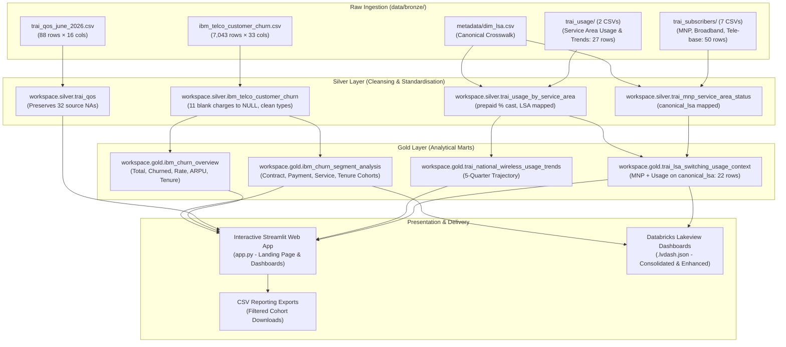

# Telecom Analytics Platform (TelecomNexus)
### Enterprise Data Lakehouse & Retention Analytics Platform

[](https://www.python.org/)
[](https://www.databricks.com/)
[](https://streamlit.io/)
[](https://plotly.com/)
[]()

---

## 1. Executive Summary

The **Telecom Analytics Platform (TelecomNexus)** is an end-to-end Big Data Engineering and Analytics platform developed as a college capstone project. It bridges **macro-level industry regulatory dynamics** with **micro-level customer retention analytics** by deploying a **Medallion Lakehouse Architecture (Bronze → Silver → Gold)**.

### Core Objectives
1. **TRAI Telecom Industry Analytics (Macro Domain):** Evaluates national switching behavior via Mobile Number Portability (MNP), Licensed Service Area (LSA) usage trends, Average Revenue Per User (ARPU), Minutes of Usage (MOU), and 13 Quality of Service (QoS) parameters across 22 telecom circles in India.
2. **IBM Customer Churn Analytics (Micro Domain):** Uncovers customer retention patterns, contractual tenure risks, payment friction, and pricing sensitivities across 7,043 enterprise customer accounts.
3. **Unified Full-Stack Integration:** Delivers an enterprise web application with interactive filtering, dual-mode database connectivity (Live Databricks SQL Warehouse or embedded high-performance SQL pipeline), and enhanced Databricks Lakeview Dashboards.

---

## 2. Architectural Design & Medallion Pipeline



### Domain Separation Policy
As defined in `metadata/join_contract.md`, **TRAI regulatory datasets and IBM customer data are strictly separated**:
- **TRAI Data Grain:** Aggregated at Licensed Service Area (LSA) and Operator level for the Indian market.
- **IBM Telco Grain:** Individual customer accounts (US California region).
- **MNP vs Churn Principle:** Mobile Number Portability (MNP) requests represent consumer switching inquiries and portability volume, **not** confirmed customer churn.

---

## 3. Dataset Lineage & Data Quality Audit

### Summary of Source Tables (Bronze)

| Table / Source File | Records | Columns | Source File / Page | Validation Status |
| :--- | :---: | :---: | :--- | :--- |
| `ibm_telco_customer_churn.csv` | 7,043 | 33 | `Telco_customer_churn.xlsx` | PASS (11 blank Total Charges handled) |
| `trai_qos_june_2026.csv` | 88 | 16 | `PMR_20072026.pdf` (Page 2) | PASS (32 source-level NAs verified) |
| `mnp_service_area_status.csv` | 22 | 7 | `PR_No104of2026_0.pdf` (Page 11) | PASS (0 nulls, 22 LSAs mapped) |
| `usage_by_service_area.csv` | 22 | 9 | `QPIR_12102026.pdf` (Page 15) | PASS (0 nulls, 22 LSAs mapped) |
| `wireless_usage_trends.csv` | 5 | 9 | `QPIR_12102026.pdf` (Page 17) | PASS (5 Quarters QE Jun-25 to Jun-26) |
| `fixed_wired_broadband.csv` | 5 | 7 | `PR_No104of2026_0.pdf` (Page 3) | PASS (Top 5 providers) |
| `wireless_broadband.csv` | 5 | 7 | `PR_No104of2026_0.pdf` (Page 3) | PASS (Top 5 providers) |
| `circle_wise_growth_rates.csv` | 5 | 8 | `PR_No104of2026_0.pdf` | PASS (Metro, Circle A, B, C, Total) |
| `circle_wise_net_additions.csv` | 5 | 8 | `PR_No104of2026_0.pdf` | PASS (Wireline & Wireless additions) |
| `telephone_subscriber_base.csv` | 6 | 5 | `PR_No104of2026_0.pdf` | PASS (Total, Urban, Rural breakdown) |
| `wireless_mobile_subscribers.csv`| 2 | 5 | `PR_No104of2026_0.pdf` | PASS (Urban vs Rural distribution) |

### Key Data Cleansing & Governance Findings
1. **IBM Total Charges (11 Whitespace Records):**
   - 11 records had whitespace strings for `Total Charges`. All 11 records have `Tenure Months = 0` (new subscribers who have not yet received their first bill).
   - In Silver processing, whitespace is safely converted to `NULL` (avoiding artificial zeros that distort ARPU).
2. **IBM Senior Citizen Representation:**
   - Raw data contains `'Yes'` / `'No'` string values. Converting with generic `try_cast(Senior_Citizen AS INT)` yields NULL; standardisation preserves categorical fidelity.
3. **TRAI QoS Missing Values (32 Values):**
   - RJIL entries contain NA in `metric_08` (Circuit Switched DCR) because Reliance Jio operates an all-IP LTE/5G network with zero legacy circuit-switched infrastructure.
   - MTNL entries contain NA in metrics 09–13 due to absence of 4G/5G deployment.
   - These are verified source-level physical realities, preserved as `NULL` rather than replaced with zeros.
4. **Canonical Service Area Alignment:**
   - The canonical crosswalk `metadata/dim_lsa.csv` maps diverse name conventions (e.g. `'Andhra Pradesh'`, `'AP'`, `'UP(E)'`, `'U.P. (East)'`) into standard ISO-like keys (`AP`, `DL`, `UPE`, etc.), achieving a **100% clean join across all 22 circles**.

---

## 4. Key Business Findings & Analytical Insights

### Module A: TRAI Telecom Industry Analytics
- **Porting Surge (June 2026):** MNP requests reached **14.79 Million** in June 2026, up **+2.21% MoM** from 14.47 Million in May 2026.
- **Zonal Distribution:** Zone I (North and West India) generated **7.96 Million** requests (53.8%), while Zone II (South and East India) generated **6.83 Million** (46.2%).
- **ARPU Dynamics:**
  - National Average ARPU stands at **₹ 187.95 / subscriber / month**.
  - Zone II records higher average revenue (**₹ 195.64**) compared to Zone I (**₹ 180.27**).
  - Top ARPU LSAs: Delhi (₹ 128 / mo prepaid heavy, high postpaid volume), Kerala, Karnataka, and Mumbai lead in data revenue realization.
- **Prepaid Dominance:** The Indian wireless market is overwhelmingly prepaid, with a national average of **82.77%** (Circle C circles exceed 92%).
- **Broadband Market Consolidation:**
  - **Wireless Broadband:** Reliance Jio commands **517.63 Million** subscribers, followed by Bharti Airtel (**368.85 Million**), and Vodafone Idea (**130.12 Million**).
  - **Fixed Wired Broadband:** Reliance Jio leads with **14.57 Million**, followed by Bharti Airtel with **11.12 Million** and BSNL with **4.52 Million**.

### Module B: IBM Customer Churn Analytics
- **Overall Churn Rate:** **26.54%** (1,869 churned out of 7,043 customers).
- **Contract Type Risk:**
  - **Month-to-Month:** **42.71% churn rate** (Highest risk cohort).
  - **One-Year Contract:** **11.27% churn rate**.
  - **Two-Year Contract:** **2.83% churn rate** (Strongest retention anchor).
- **Payment Method Exposure:**
  - **Electronic Check:** Records an alarming **45.29% churn rate** (3.0× higher than automated methods).
  - **Automated Bank Transfer:** **16.71%**.
  - **Automated Credit Card:** **15.24%**.
- **Service Type Driver:**
  - **Fiber Optic Subscribers:** Churn at **41.89%** despite paying premium rates ($70–$110/mo), primarily driven by dissatisfaction with tech support and competitor pricing.
  - **DSL Subscribers:** Churn at **18.96%**.
  - **No Internet (Phone Only):** Churn at **7.40%**.
- **Tenure Vulnerability Window:**
  - **0–12 Months (Early Life):** **47.68% churn rate**. Over 50% of all customer departures occur in the first year of onboarding.
  - **49+ Months (Long-Term Loyal):** Drops to **9.47%**.

---

## 5. Technology Stack

- **Data Engineering & Lakehouse:** Databricks, Apache Spark / PySpark, Delta Lake.
- **Analytical Querying:** ANSI SQL, Databricks SQL Warehouse, SQLite embedded engine.
- **Web Application & UI:** Python 3.12, Streamlit 1.58.0.
- **Data Visualizations:** Plotly Interactive Visuals (Plotly Express & Graph Objects).
- **Data Processing:** Pandas, NumPy, PyArrow.
- **Document & PDF Parsing:** pdfplumber, PyMuPDF (fitz), openpyxl.

---

## 6. Project Structure

```text
Telecom-Project-main/
├── app.py                                         # Streamlit Main Application & Landing Page
├── requirements.txt                               # Application & Library Dependencies
├── README.md                                      # Comprehensive Project Documentation
├── .env.example                                   # Databricks Credentials Template
│
├── modules/                                       # Core Analytics Dashboard Modules
│   ├── trai_analytics.py                          # Module A: TRAI Industry & QoS Analytics
│   └── ibm_churn.py                               # Module B: IBM Customer Churn Analytics
│
├── utils/                                         # Shared Utilities & Data Connectors
│   ├── database.py                                # Dual-Mode Data Access Layer (Databricks/Local)
│   └── styling.py                                 # Enterprise Navy Blue Design System & Plotly Themes
│
├── tests/                                         # Automated Verification Suite
│   └── test_platform.py                           # 7 Comprehensive Unit & Integration Tests
│
├── data/
│   └── bronze/                                    # Raw Ingested CSV Datasets
│       ├── ibm_telco/                             # IBM Telco Customer Churn (7,043 rows)
│       ├── trai_qos/                              # TRAI QoS June 2026 (88 rows)
│       ├── trai_subscribers/                      # 7 MNP & Subscriber CSVs (50 rows)
│       └── trai_usage/                            # 2 Usage & Trends CSVs (27 rows)
│
├── metadata/                                      # Data Dictionaries & Governance Contracts
│   ├── dim_lsa.csv                                # Canonical LSA Crosswalk Key
│   ├── join_contract.md                           # Approved Join Grain & Separation Rules
│   ├── ibm_telco_data_dictionary.csv              # IBM Data Dictionary
│   ├── ibm_telco_data_quality_report.md           # IBM Quality & Whitespace Audit
│   ├── qos_data_dictionary.csv                    # QoS Metric 01-13 Specifications
│   ├── subscriber_data_dictionary.csv             # Subscriber Tables Schema
│   └── trai_usage_data_dictionary.csv             # Usage Metrics Schema
│
├── notebooks/
│   └── 01_bronze_ingestion.ipynb                  # Databricks PySpark Bronze -> Silver -> Gold Pipeline
│
├── TRAI Dashboard/                                # TRAI Databricks SQL & Lakeview Dashboards
│   ├── TRAI Overview Analysis.dbquery.ipynb       # Original TRAI Query Notebook
│   ├── Average ARPU Analysis.dbquery.ipynb        # ARPU by Zone Query
│   ├── Porting Requests by LSA.dbquery.ipynb      # Porting by Circle Query
│   ├── Porting Requests by Zone.dbquery.ipynb     # Porting by Zone Query
│   ├── Porting Requests by Month.dbquery.ipynb    # Porting MoM Query
│   ├── Prepaid Percentage Analysis.dbquery.ipynb  # Prepaid Ratio Query
│   ├── Telecom Usage Analysis.dbquery.ipynb       # MOU Usage Query
│   ├── TRAI Telecom Analysis Dashboard.lvdash.json# Original Lakeview Dashboard
│   └── TRAI_Telecom_Consolidated_Dashboard.lvdash.json # Enhanced Consolidated Lakeview JSON
│
└── IBM Customer Churn Analysis/                   # IBM Databricks SQL & Lakeview Dashboards
    ├── SQL Queries.dbquery.ipynb                  # Original IBM SQL Notebook & Segment View
    ├── IBM Customer Churn Analysis Dashboard.lvdash.json # Original Lakeview Dashboard
    └── IBM_Customer_Churn_Enhanced_Dashboard.lvdash.json # Enhanced Lakeview JSON
```

---

## 7. Setup & Execution Guide

### Prerequisites
- Python 3.10, 3.11, or 3.12 installed on your operating system.

### Step 1: Install Dependencies
Open your command terminal in the project root directory and run:
```bash
pip install -r requirements.txt
```

### Step 2: Run the Verification Test Suite
Verify that all database connections, schema queries, KPI formulas, and export routines pass:
```bash
python -m unittest tests/test_platform.py
```
*Expected Output: `Ran 7 tests in ~0.9s ... OK`*

### Step 3: Launch the Interactive Web Application
Start the Streamlit application:
```bash
streamlit run app.py
```
The application will launch automatically in your web browser at:
`http://localhost:8501`

---

## 8. Databricks SQL Warehouse Integration (Optional)

The application features an **intelligent dual-mode connector (`utils/database.py`)**:
- **Default Mode (Local Verified Pipeline):** Automatically loads the clean Silver and Gold relational tables created directly from your repository's datasets. No cloud credentials required. Perfect for local demos, offline testing, and presentations.
- **Live Warehouse Mode:** To connect directly to a live Databricks Serverless SQL Warehouse or All-Purpose Cluster, create a `.env` file in the root directory:

```env
DATABRICKS_SERVER_HOSTNAME=adb-xxxxxxxxxxxxxxxx.xx.azuredatabricks.net
DATABRICKS_HTTP_PATH=/sql/1.0/warehouses/xxxxxxxxxxxxxxxx
DATABRICKS_TOKEN=dapixxxxxxxxxxxxxxxxxxxxxxxxxxxxxxxx
```
*(Also install `databricks-sql-connector`: `pip install databricks-sql-connector`)*

The platform will automatically detect credentials and switch the badge from **`Local Verified Pipeline Active`** to **`Live Databricks Connected`**.

---

## 9. Databricks Lakeview Dashboards

To import the enhanced dashboards into your Databricks Workspace:
1. Open your Databricks workspace.
2. In the sidebar, navigate to **Dashboards** → Click **Create Dashboard**.
3. Click the three dots menu (`...`) in the upper right → Select **Import/Upload Dashboard Definition**.
4. Choose:
   - `TRAI Dashboard/TRAI_Telecom_Consolidated_Dashboard.lvdash.json` for the TRAI industry dashboard.
   - `IBM Customer Churn Analysis/IBM_Customer_Churn_Enhanced_Dashboard.lvdash.json` for the IBM customer churn dashboard.
5. Link your SQL warehouse compute to preview all visualizations live.

---

## 10. College Viva & Presentation Guide

### Quick Demonstration Flow for Evaluators:
1. **Landing Page (`app.py`):** Show the executive summary, architecture diagram, and contrast Macro vs Micro telecom domains.
2. **TRAI Industry Analytics Module:**
   - Walk through the KPI cards (14.79M MNP requests, ₹ 188 ARPU, 82.8% prepaid).
   - Show the interactive Zone filter: toggle Zone I vs Zone II and demonstrate how LSAs update.
   - Present the Operator Market Share pie charts (Jio leads wireless at 517M; Jio leads wired broadband at 14.5M).
   - Highlight the QoS benchmark (latency, downtime, packet loss) across Airtel, Jio, Vi, BSNL, and MTNL.
   - Click **Export Filtered Data (CSV)** to show data governance.
3. **IBM Customer Churn Analytics Module:**
   - Highlight the 26.54% churn rate across 7,043 customers.
   - Demonstrate the Contract Type chart: explain why Month-to-Month customers churn at 42.7% vs 2.8% for Two-Year contracts.
   - Filter by **Payment Method = Electronic Check**: show that churn rate spikes to 45.3%.
   - Show the Customer Risk Matrix and churn reason Pareto chart ("Competitor made better offer").
   - Click **Export Cohort (CSV)** for targeted retention campaigns.
4. **Data Governance & Integrity:**
   - Explain the 11 blank charges (Tenure=0 new customers).
   - Explain the 32 missing values in TRAI QoS (physical network realities, not data corruption).

---

## 11. Authors & Acknowledgments

- **Project:** Telecom Analytics Platform (TelecomNexus)
- **Academic Context:** Big Data Engineering & Telecom Analytics Capstone Project
- **Data Sources:** Telecom Regulatory Authority of India (TRAI) Reports & IBM Telco Customer Churn Dataset (Kaggle)
