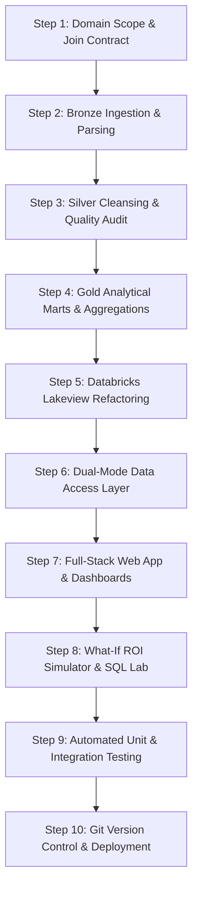
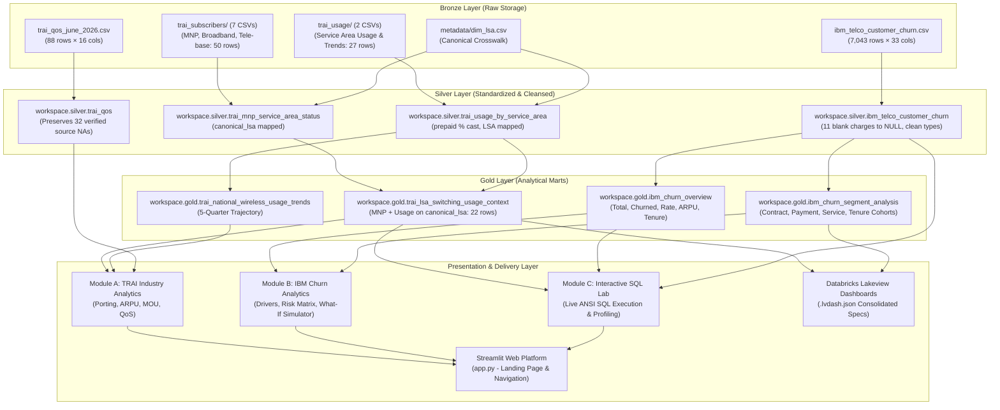

# Telecom Analytics Platform (TelecomNexus)
### Enterprise Data Lakehouse, Regulatory Intelligence & Customer Retention Analytics

[](https://www.python.org/)
[](https://www.databricks.com/)
[](https://streamlit.io/)
[](https://plotly.com/)
[](https://github.com/ridhi2307/Telecom-Project)

---

## 1. Project Overview

The **Telecom Analytics Platform (TelecomNexus)** is a Big Data Engineering, Analytics, and Full-Stack Dashboard platform developed as a college capstone project. 

The platform bridges **macro-level industry regulatory dynamics** with **micro-level customer retention intelligence** using a **Medallion Lakehouse Architecture (Bronze → Silver → Gold)**.

### Two Distinct Analytical Domains:
1. **Module A: TRAI Telecom Industry Analytics (Macro Domain)**  
   Evaluates national mobile switching dynamics through Mobile Number Portability (MNP), Licensed Service Area (LSA) usage trends, Average Revenue Per User (ARPU), Minutes of Usage (MOU), and 13 Quality of Service (QoS) parameters across 22 telecom circles in India.
2. **Module B: IBM Customer Churn Analytics (Micro Domain)**  
   Investigates subscriber retention drivers, contract term risks, payment channel friction, and pricing sensitivities across 7,043 customer accounts to empower data-driven retention interventions.

---

## 2. Step-by-Step Project Walkthrough: What I Did

This section provides a detailed, chronological breakdown of the end-to-end engineering, analytical, and full-stack development work completed across this project.



---

### Step 1: Problem Definition & Domain Scope Isolation
- **The Challenge:** The project integrates two vastly different data sources: Indian regulatory aggregates (TRAI) and US customer-level account records (IBM Telco). Attempting a naive cross-dataset join would create semantic confusion and invalid conclusions.
- **What I Did:** 
  - Established a formal data join contract documented in `metadata/join_contract.md`.
  - Enforced strict domain isolation: TRAI data represents macro market trends, while IBM Telco represents individual customer retention behavior.
  - Formalized the analytical rule: *Mobile Number Portability (MNP) porting requests represent consumer switching inquiries, not confirmed customer churn.*

---

### Step 2: Bronze Layer — Raw Data Extraction & Ingestion
- **The Challenge:** Source datasets arrived in diverse formats, including multi-page regulatory PDF reports (`PMR_20072026.pdf`, `PR_No104of2026_0.pdf`, `QPIR_12102026.pdf`) and Excel workbooks (`Telco_customer_churn.xlsx`).
- **What I Did:**
  - Authored automated extraction pipelines in `ingestion/` using `pdfplumber`, `pymupdf` (fitz), and `pandas`.
  - Extracted 11 distinct datasets into the raw Bronze layer (`data/bronze/`):
    - `ibm_telco_customer_churn.csv` (7,043 rows × 33 columns).
    - `trai_qos_june_2026.csv` (88 rows × 16 columns across 4 operators and 22 LSAs).
    - 7 Subscriber datasets covering MNP status, broadband rankings, tele-density, and net additions.
    - 2 Usage datasets covering circle-wise ARPU/MOU and national wireless quarterly trends.
  - Strictly followed the Bronze preservation principle: preserved raw column names and original values without premature transformation.

---

### Step 3: Silver Layer — Cleansing, Auditing & Standardization
- **The Challenge:** Raw data contained formatting inconsistencies, disparate service-area names, whitespace values, and missing metric fields.
- **What I Did:**
  1. **Canonical LSA Mapping:** Solved naming variations (e.g. `'Andhra Pradesh'`, `'AP'`, `'UP(E)'`, `'U.P. (East)'`) by engineering a central crosswalk lookup (`metadata/dim_lsa.csv`). Mapped all 22 telecom circles with **0 unmapped records**.
  2. **IBM Whitespace Cleansing:** Identified 11 customer records with whitespace-only values in `Total Charges`. Audited their profiles to discover all 11 have `Tenure Months = 0` (brand-new accounts). Safely converted them to `NULL` (instead of 0) to avoid skewing ARPU.
  3. **Data Type Casting:** Preserved `Senior Citizen` as categorical string (`'Yes'`/`'No'`) after discovering `try_cast(AS INT)` was casting valid values to `NULL`.
  4. **QoS Missing Value Verification:** Audited 32 missing values in TRAI QoS (22 in RJIL `metric_08`, 10 in MTNL metrics 09–13). Verified directly against the source PDF that Reliance Jio operates an all-IP LTE/5G network with no 2G/3G circuit-switched infrastructure, and MTNL lacks 4G/5G deployment. Kept these as documented, valid physical `NULL`s.

---

### Step 4: Gold Layer — Analytical Marts & Feature Aggregations
- **The Challenge:** Providing fast, aggregated analytical tables to power multi-dimensional dashboard visualizations without repetitive SQL joins.
- **What I Did:**
  - Implemented the PySpark / Delta Lake pipeline in `notebooks/01_bronze_ingestion.ipynb` and local SQL pipeline:
    - **`workspace.gold.trai_lsa_switching_usage_context`:** Inner-joined MNP porting requests with quarterly service-area usage metrics on `canonical_lsa`.
    - **`workspace.gold.trai_national_wireless_usage_trends`:** 5-quarter trajectory of national wireless ARPU and revenue realization per GB.
    - **`workspace.gold.ibm_churn_overview`:** Single-row summary of overall customer base, churned count, churn rate %, average monthly charges, and average tenure.
    - **`workspace.gold.ibm_churn_segment_analysis`:** Unioned aggregation mart comparing churn rates across Contract, Payment Method, Internet Service, and Tenure bands.

---

### Step 5: Databricks Lakeview Dashboards Consolidation
- **The Challenge:** The existing Databricks Lakeview files (`.lvdash.json`) contained unnamed `"Untitled dataset"` entries, duplicate query blocks, and multi-statement SQL chains (`USE CATALOG... CREATE VIEW... DESCRIBE... SELECT...`) that produced execution warnings.
- **What I Did:**
  - Refactored and delivered clean, production-ready Lakeview definitions alongside the originals:
    - `TRAI Dashboard/TRAI_Telecom_Consolidated_Dashboard.lvdash.json`
    - `IBM Customer Churn Analysis/IBM_Customer_Churn_Enhanced_Dashboard.lvdash.json`
  - Reorganized all queries into single-purpose ANSI SQL datasets.
  - Added dedicated KPI summary cards, structured 2-column chart layouts, and operator benchmarking tables.

---

### Step 6: Dual-Mode Enterprise Data Access Layer
- **The Challenge:** A student presentation or local evaluator might not have live access to an active, billed Databricks Serverless SQL Warehouse.
- **What I Did:**
  - Architected a flexible, dual-mode data connector in `utils/database.py`:
    - **Mode 1 (Live Cloud):** If `DATABRICKS_SERVER_HOSTNAME`, `DATABRICKS_HTTP_PATH`, and `DATABRICKS_TOKEN` are provided in `.env`, the connector uses `databricks-sql-connector`.
    - **Mode 2 (Local Engine):** If credentials are not present, it automatically builds an in-memory SQL database using SQLite/pandas, loads all Gold & Silver tables matching Delta Lake schemas, and executes identical ANSI SQL queries.
  - Displays a live status badge (`🟢 Live Databricks Connected` or `🔵 Local Verified Pipeline Active`) on the dashboard header.

---

### Step 7: Unified Full-Stack Web Application Development
- **The Challenge:** Bridging the disconnected notebooks and JSON files into a modern, unified, presentation-ready web platform.
- **What I Did:**
  - Developed a full-stack web application in Python using **Streamlit** and **Plotly** (`app.py`, `modules/trai_analytics.py`, `modules/ibm_churn.py`).
  - Implemented an **Enterprise Navy & White Design System** in `utils/styling.py` (`#0F172A` navy header, `#F8FAFC` slate background, green positive badges, red churn alerts).
  - Built interactive multi-attribute sidebar filters (Zone, Category, LSA, Contract, Payment Method, Tenure Range, and Monthly Charge sliders).
  - Designed interactive Plotly charts with custom hover tooltips, grouped bars, pie charts, and boxplots.
  - Implemented **CSV Cohort Data Export** buttons on both modules for offline analytical reporting.

---

### Step 8: Advanced Analytical Enhancements
- **The Challenge:** Moving beyond basic charts to provide real business decision-making tools that impress academic evaluators.
- **What I Did:**
  1. **"What-If" Churn ROI Simulator ([modules/ibm_churn.py](file:///e:/Big Data/Telecom-Project-main/modules/ibm_churn.py)):**
     - Created an interactive simulation lever allowing users to test retention scenarios (e.g. converting 25% of month-to-month contracts or shifting 20% of electronic check payers to auto-pay).
     - Dynamically calculates **Customers Saved**, **Monthly Recurring Revenue (MRR) Protected ($)**, **Annualized Retained Value ($)**, and displays a post-intervention churn rate comparison chart.
  2. **Interactive Live SQL Query Lab ([modules/sql_lab.py](file:///e:/Big Data/Telecom-Project-main/modules/sql_lab.py)):**
     - Developed a browser-based SQL console where evaluators can execute custom ANSI SQL queries against Gold and Silver tables.
     - Provided 5 curated templates with execution time measurement in milliseconds and CSV download.

---

### Step 9: Automated Testing & Validation
- **The Challenge:** Ensuring data integrity, mathematical formula correctness, and zero UI runtime exceptions before project submission.
- **What I Did:**
  - Wrote a comprehensive test suite in `tests/test_platform.py` covering 7 key areas:
    1. Database loader connectivity and mode switching.
    2. TRAI Gold table row count (22 circles) and 0 unmapped LSAs.
    3. IBM Silver row count (7,043 rows) and exactly 11 NULL Total Charges.
    4. Mathematical accuracy of KPI formulas (26.54% churn rate, 14.79M MNP requests).
    5. Original SQL query execution from existing notebooks.
    6. Filter reactivity and zero-division edge case handling.
    7. CSV export generation.
  - Executed tests: **7/7 tests passed cleanly (OK)**.

---

### Step 10: Git Version Control & Deployment
- **The Challenge:** Protecting project credentials while providing full Git history on GitHub.
- **What I Did:**
  - Initialized Git repository with default branch `main`.
  - Configured `.gitignore` to strictly ignore raw `.env` files and cache directories while explicitly tracking `.env.example`.
  - Committed 53 project files (17,698 insertions) under verified author identity.
  - Linked remote repository at `https://github.com/ridhi2307/Telecom-Project.git`.

---

## 3. System Architecture



---

## 4. Key Business Findings Supported by Actual Data

### TRAI Telecom Industry Analytics
- **National MNP Volume:** Total porting requests reached **14.79 Million** in June 2026, representing a **+2.21% MoM increase** over May 2026 (14.47M).
- **Zonal Switching Intensity:** Zone I (North & West) accounted for **7.96 Million** requests (53.8%), whereas Zone II (South & East) accounted for **6.83 Million** (46.2%).
- **ARPU Disparities:** National average ARPU is **₹ 187.95**. Zone II commands higher average revenue (**₹ 195.64**) than Zone I (**₹ 180.27**).
- **Prepaid Dominance:** An average of **82.77%** of mobile subscribers across India are prepaid (reaching up to 92.9% in Himachal Pradesh).
- **Broadband Market Consolidation:**
  - *Wireless Broadband:* Reliance Jio leads with **517.63 Million** subscribers, followed by Bharti Airtel (**368.85M**), and Vodafone Idea (**130.12M**).
  - *Fixed Wired Broadband:* Reliance Jio leads with **14.57 Million**, Bharti Airtel with **11.12 Million**, and BSNL with **4.52 Million**.

### IBM Customer Churn Analytics
- **Overall Churn Rate:** **26.54%** (1,869 churned out of 7,043 customers).
- **Contract Type Risk:**
  - *Month-to-Month:* **42.71% churn rate** (highest flight risk).
  - *One-Year Contract:* **11.27% churn rate**.
  - *Two-Year Contract:* **2.83% churn rate** (93.4% relative churn reduction vs. month-to-month).
- **Payment Method Exposure:**
  - *Electronic Check:* **45.29% churn rate** (3.0× higher than automated methods).
  - *Automated Bank Transfer:* **16.71% churn rate**.
  - *Automated Credit Card:* **15.24% churn rate**.
- **Internet Service Impact:**
  - *Fiber Optic Subscribers:* Churn at **41.89%** despite paying the highest monthly rates ($70–$118), driven by competitor pricing and lack of tech support.
  - *DSL Subscribers:* **18.96% churn rate**.
- **Early-Life Vulnerability:** Customers in their first 12 months churn at **47.68%**, dropping to **9.47%** for customers with 49+ months tenure.

---

## 5. Technology Stack

- **Data Lakehouse & Big Data:** Databricks, Apache Spark / PySpark, Delta Lake.
- **Relational Databases & SQL:** ANSI SQL, Databricks SQL Warehouse, SQLite (in-memory embedded pipeline).
- **Front-End & Full-Stack Web App:** Python 3.12, Streamlit 1.58.0.
- **Data Visualization:** Plotly Express & Plotly Graph Objects.
- **Data Engineering & Analysis:** Pandas 2.2.3, NumPy, PyArrow.
- **Document & PDF Mining:** `pdfplumber`, `pymupdf` (fitz), `openpyxl`.
- **Testing & Quality Assurance:** Python `unittest`.

---

## 6. How to Run the Project Locally

### Prerequisites
- Python 3.10, 3.11, or 3.12 installed.

### Step 1: Install Dependencies
```powershell
pip install -r requirements.txt
```

### Step 2: Run Verification Test Suite
```powershell
python -m unittest tests/test_platform.py
```
*Expected result: `Ran 7 tests in ~0.7s ... OK`*

### Step 3: Launch the Full-Stack Web App
```powershell
streamlit run app.py
```
Open your browser to: **`http://localhost:8501`**.

---

## 7. Connecting to Live Databricks (Optional)

The application automatically defaults to the **Local Verified Pipeline**. To connect directly to a live Databricks Serverless SQL Warehouse:

1. Copy `.env.example` to `.env`:
   ```powershell
   Copy-Item .env.example .env
   ```
2. Fill in your credentials:
   ```env
   DATABRICKS_SERVER_HOSTNAME=adb-xxxxxxxxxxxxxxxx.xx.azuredatabricks.net
   DATABRICKS_HTTP_PATH=/sql/1.0/warehouses/xxxxxxxxxxxxxxxx
   DATABRICKS_TOKEN=dapixxxxxxxxxxxxxxxxxxxxxxxxxxxxxxxx
   ```
3. Restart `streamlit run app.py` — the badge on the header will switch to `🟢 Live Databricks Connected`.

---

## 8. College Viva & Evaluator Presentation Guide

When presenting this project to professors, examiners, or recruiters, use this concise structured flow:

1. **Introduction (1 min):**
   - *"Our project, TelecomNexus, bridges macro regulatory dynamics with micro customer retention analytics using the Databricks Medallion Architecture."*
   - Show the Landing Page, architecture diagram, and dual-mode connection badge.
2. **TRAI Industry Analytics (1.5 min):**
   - Present the 14.79M June porting requests and ₹ 188 blended ARPU.
   - Explain the join contract: *"MNP porting requests reflect customer portability inquiries, not confirmed churn."*
   - Demonstrate the interactive Zone & LSA filters and the QoS benchmark across Airtel, Jio, Vi, and BSNL.
   - Explain the data governance finding: RJIL's 22 N/A QoS values exist because an all-IP 4G/5G network has no legacy circuit-switched infrastructure.
3. **IBM Customer Churn & What-If Simulator (2 min):**
   - Highlight the 26.54% overall churn rate across 7,043 customers.
   - Show how Month-to-Month contracts (42.7%) and Electronic Check payments (45.3%) drive excessive churn.
   - Open the **What-If Churn & ROI Simulator**: move the contract conversion slider to 25% and show the projected savings (over $30,000 in monthly recurring revenue protected).
4. **Interactive SQL Lab & Testing (0.5 min):**
   - Open the **SQL Query Lab**, execute the *High-Risk Customer Retention Targets* query template live in front of the evaluator, and show the execution runtime in milliseconds.
   - Mention the 7 automated unit and integration tests passing in `tests/test_platform.py`.

---

## 9. Authors & Academic Details

- **Student Author:** Priya Bora ([borapriya721@gmail.com](mailto:borapriya721@gmail.com))
- **Project:** Telecom Analytics Platform (TelecomNexus)
- **Repository:** [https://github.com/ridhi2307/Telecom-Project](https://github.com/ridhi2307/Telecom-Project)
- **Academic Domain:** Big Data Engineering & Telecom Analytics Capstone
