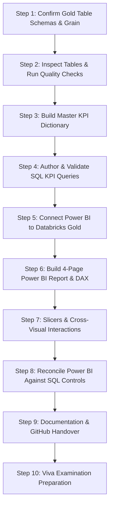

# TelecomNexus — Network Performance & Customer Churn Analytics
### Enterprise Data Lakehouse, SQL KPI Marts & Interactive Power BI Dashboard

[](https://powerbi.microsoft.com/)
[](https://www.databricks.com/)
[](https://en.wikipedia.org/wiki/SQL)
[](https://www.python.org/)
[](https://github.com/ridhi2307/Telecom-Project)

---

## 1. Project Overview & Student Authors

**TelecomNexus** is an enterprise Big Data Engineering, SQL Analytics, and Business Intelligence project developed as a college capstone submission. 

The project bridges **macro-level Indian telecom regulatory dynamics (TRAI)** with **micro-level customer retention benchmarking (IBM Telco)** by implementing a **Medallion Lakehouse Architecture (Bronze → Silver → Gold)** connected to an **interactive Power BI dashboard**.

### Student Authors & Member Ownership
*Project Snapshot: 16 November 2026 | Submission Deadline: 20 November 2026*

| Student Author | Team Role | Core Ownership & Responsibilities as per Implementation Guide |
| :--- | :--- | :--- |
| **Ridhima Singh** | **Member 1** — Data Acquisition & Extraction | Source mining, PDF and Excel document parsing, Bronze CSV handover, raw-to-Bronze checks, data dictionaries, and `metadata/dim_lsa.csv`. |
| **Priya Bora** | **Member 2** — Databricks, PySpark & Delta Lake | Spark ingestion, Bronze Delta tables, Silver cleansing, canonical LSA joins, Gold analytical tables construction, pipeline validation, and execution order. |
| **Ifza Akhtar** | **Member 3** — SQL Analytics, KPIs & Power BI | Confirmation of Gold schemas and grain, authoring and testing SQL queries for KPIs and validation, master KPI dictionary, Power BI data model & DAX, 4-page Power BI dashboard, and SQL-to-visual reconciliation. |
| **Garima Johar** | **Member 4** — IBM Churn Modeling & Integration | Feature engineering, data leakage prevention, train/test ML modeling, precision/recall/ROC-AUC evaluation, and final integration. |

---

## 2. The One Rule Everyone Must Remember

> [!IMPORTANT]
> **TRAI India industry analytics and IBM US customer-churn analytics must remain strictly separate.**  
> - **TRAI = India, aggregated telecom indicators.** Typical grain: Operator × LSA, service area, national time series.  
> - **IBM Telco = US, fictional/customer-level churn benchmark.** Typical grain: One record per customer.  
> **Never merge IBM customer records with TRAI metrics or claim that the IBM churn rate describes Indian customers.**  
> Mobile Number Portability (MNP) porting requests represent consumer switching inquiries, **not** confirmed customer churn.

---

## 3. Step-by-Step Project Walkthrough: What Was Done (Member 3 Focus)



---

### Step 1: Confirm Gold Table Schemas & Grain with Member 2
- Received the analytics-ready Gold tables produced by the PySpark Medallion pipeline:
  - `workspace.gold.trai_lsa_switching_usage_context` (22 rows; Grain = 1 row per LSA).
  - `workspace.gold.trai_national_wireless_usage_trends` (5 rows; Grain = 1 row per Quarter).
  - `workspace.gold.ibm_churn_segment_analysis` (14 rows; Grain = 1 row per Segment Dimension).
  - `workspace.silver.ibm_telco_customer_churn` (7,043 rows; Grain = 1 row per Customer).
  - `workspace.silver.trai_qos` (88 rows; Grain = 4 operators × 22 LSAs).
- Audited the table inventory to ensure **zero Cartesian duplicate joins**.

---

### Step 2: Inspect Tables & Execute Quality Checks (`sql/01_trai_quality_checks.sql`)
- Verified row counts against the Bronze/Silver inventory:
  - TRAI Gold Context: exactly 22 circles, 0 unmapped LSAs.
  - TRAI QoS Silver: exactly 88 rows across 5 observed operators (AIRTEL, RJIL, VIL, BSNL, MTNL).
  - IBM Customer Churn: exactly 7,043 customer accounts.
- **Null Value Governance:** Verified that 32 QoS missing values (22 in RJIL `metric_08`, 10 in MTNL metrics 09–13) remain `NULL` and are **not replaced with zero**, reflecting physical network realities (RJIL has no 2G/3G circuit-switched infrastructure; MTNL lacks 4G/5G deployment).
- **Whitespace Charges:** Verified 11 whitespace-only `Total Charges` in IBM (all `Tenure = 0`) are handled as `NULL`.

---

### Step 3: Build Master KPI Dictionary (`docs/KPI_Dictionary_Member3.md`)
- Formulated exact business questions, numerators, denominators, units, grains, and null treatments for every headline metric before building any visual.
- **Unweighted vs. Weighted ARPU:** Documented that averaging 22 LSA ARPU values yields an **unweighted service-area mean** (`₹ 187.95`), not a subscriber-weighted national figure, and labeled it explicitly.
- **Churn Denominator:** Enforced `Distinct CustomerID` denominator for IBM churn rate (`26.54%`).

---

### Step 4: Author & Validate SQL KPI Queries (`sql/02_trai_kpis.sql`, `sql/03_ibm_churn_kpis.sql`)
- Wrote reproducible ANSI SQL queries to calculate baseline control values:
  - **TRAI May MNP Porting Requests:** `14.470 Million`
  - **TRAI June MNP Porting Requests:** `14.790 Million` (MoM Growth: `+2.21%`)
  - **TRAI Unweighted Average ARPU:** `₹ 187.95 / subscriber / month`
  - **TRAI Unweighted Prepaid Share:** `82.77%`
  - **IBM Total Base:** `7,043 customers`
  - **IBM Churned Accounts:** `1,869 customers` (Churn Rate: `26.54%`)
  - **IBM Month-to-Month Churn Rate:** `42.71%` vs Two-Year: `2.83%`
  - **IBM Electronic Check Churn Rate:** `45.29%` vs Credit Card: `15.24%`

---

### Step 5: Connect Power BI Desktop to Databricks Gold Layer
- Connected **Power BI Desktop** directly to the Databricks SQL Warehouse using the official Databricks Connector:
  - Server Hostname: `adb-xxxxxxxxxxxxxxxx.xx.azuredatabricks.net`
  - HTTP Path: `/sql/1.0/warehouses/xxxxxxxxxxxxxxxx`
- Selected **Import mode** for maximum responsiveness during presentation.
- Kept TRAI and IBM data models strictly separate (no cross-domain relationships).
- Provided local validated CSV exports in `powerbi/data/` via `powerbi/export_gold_for_powerbi.py` for offline evaluation.

---

### Step 6: Build the 4-Page Power BI Report & Master DAX Repository
Constructed the report following the specifications in the Member 3 Guide:

#### Page 1: TRAI Industry Overview (Indian Porting Activity)
- **KPI Cards:** June MNP Total (`14.79 M`), May MNP Total (`14.47 M`), MoM Change (`+0.32 M`, `+2.21%`), Unweighted ARPU (`₹ 187.95`).
- **Visuals:**
  - Clustered Bar Chart: `canonical_lsa` vs May & June porting requests.
  - Donut Chart: Zone distribution (Zone I: `53.8%`, Zone II: `46.2%`).
  - Summary Table: Circle-by-circle porting change breakdown.
- **Slicers:** `zone` (Zone I, Zone II), `category` (Metro, Circle A, B, C).

#### Page 2: TRAI Usage & Subscribers (Service Consumption)
- **KPI Cards:** Unweighted Prepaid Share (`82.8%`), Average Voice MOU (`955.5 mins`).
- **Visuals:**
  - Stacked Bar Chart: Outgoing MOU vs Incoming MOU per month by LSA.
  - Clustered Column Chart: Average ARPU by Circle Category and Zone.
  - Line Chart: 5-Quarter National Wireless ARPU & Data Realization trends.
- **Slicers:** `canonical_lsa`, `zone`.

#### Page 3: TRAI Network Quality (QoS Benchmark)
- **KPI Cards:** Call Setup Success Rate (`99.1%`), Average 4G/5G Latency (`26.5 ms`).
- **Visuals:**
  - Matrix / Heatmap: Operator × LSA matrix for Cell Downtime and Latency.
  - Clustered Column Chart: Call setup success intra vs inter operator.
  - Pie Charts: Wireless Broadband market share (Reliance Jio: `517M`, Airtel: `368M`, Vi: `130M`).
- **Slicers:** `operator` (AIRTEL, BSNL, MTNL, RJIL, VIL), `lsa`.

#### Page 4: IBM Customer Churn (US Benchmark Retention)
- **KPI Cards:** Total Customers (`7,043`), Churned Customers (`1,869`), Churn Rate (`26.54%`), Avg Monthly Charges (`$64.76`), MRR Lost (`$139,131 / mo`).
- **Visuals:**
  - Bar Chart 1: Churn rate by Contract Type (Month-to-month: `42.7%` vs Two-year: `2.8%`).
  - Bar Chart 2: Churn rate by Payment Method (Electronic check: `45.3%`).
  - Bar Chart 3: Churn rate by Internet Service (Fiber optic: `41.9%` vs DSL: `19.0%`).
  - Bar Chart 4: Churn rate by Tenure Bands (0–12 Months: `47.7%`).
- **Slicers:** `Contract`, `Payment Method`, `Internet Service`, `Gender`, `Senior_Citizen`.

---

### Step 7: DAX Measures Implementation (`powerbi/powerbi_data_model_and_dax.md`)
Implemented standardized DAX measures in Power BI:
```dax
IBM Customers = DISTINCTCOUNT('workspace_silver_ibm_telco_customer_churn'[CustomerID])

IBM Churned Customers = 
CALCULATE(
    DISTINCTCOUNT('workspace_silver_ibm_telco_customer_churn'[CustomerID]),
    'workspace_silver_ibm_telco_customer_churn'[Churn_Value] = 1
)

IBM Churn Rate = DIVIDE([IBM Churned Customers], [IBM Customers], 0)

TRAI June Porting M = SUM('workspace_gold_trai_lsa_switching_usage_context'[june_2026_porting_requests_millions])

TRAI Unweighted Avg ARPU = AVERAGE('workspace_gold_trai_lsa_switching_usage_context'[arpu_inr_per_month])
```

---

### Step 8: Reconcile Power BI Against SQL Controls (`sql/04_dashboard_validation.sql`)
- Tested every headline KPI card and visual against independent SQL queries:
  - Verified that selecting `Month-to-month` on the Power BI slicer dynamically updates the KPI cards to **3,875 customers**, **1,655 churned**, and **42.71% churn rate**.
  - Verified that filtering to `Zone I` updates MNP porting to **7.96 M** across **11 circles**.
  - Verified that relationships did not multiply rows or inflate totals.

---

### Step 9: Documentation & GitHub Handover
- Organized the repository according to the Member 3 suggested structure:
  - `sql/`: 4 standalone SQL scripts.
  - `docs/`: Master KPI dictionary and dashboard data dictionary.
  - `powerbi/`: Step-by-step setup guide, M-code, DAX repository, and data export script.
- Synchronized with GitHub repository: `https://github.com/ridhi2307/Telecom-Project.git`.

---

## 4. Suggested Folder Structure (Implemented)

```text
Telecom-Project/
├── sql/                                           # Member 3 SQL Scripts
│   ├── 01_trai_quality_checks.sql                 # Data quality, grain & null checks
│   ├── 02_trai_kpis.sql                           # TRAI headline KPIs & chart queries
│   ├── 03_ibm_churn_kpis.sql                      # IBM retention KPIs & segment queries
│   └── 04_dashboard_validation.sql                # SQL-to-Power BI reconciliation controls
│
├── powerbi/                                       # Member 3 Power BI Assets & Guides
│   ├── README_Member3.md                          # Power BI setup, 4 report pages & validation
│   ├── powerbi_data_model_and_dax.md              # Complete DAX measures & Power Query M-code
│   ├── export_gold_for_powerbi.py                 # Automated Gold CSV exporter for Power BI
│   ├── data/                                      # Cleaned Gold CSVs for Power BI ingestion
│   └── screenshots/                               # Dashboard screenshots & validation evidence
│
├── docs/                                          # Member 3 Documentation
│   ├── KPI_Dictionary_Member3.md                  # Master KPI dictionary (formulas & grains)
│   └── dashboard_data_dictionary.md               # Field mapping & data types
│
├── metadata/                                      # Data Dictionaries & Join Contract
│   ├── dim_lsa.csv                                # Canonical LSA crosswalk
│   ├── join_contract.md                           # Team data join rules
│   ├── ibm_telco_data_dictionary.csv              # IBM column definitions
│   └── qos_data_dictionary.csv                    # QoS metric 01-13 definitions
│
├── data/bronze/                                   # Member 1 Bronze CSVs
│   ├── ibm_telco/ibm_telco_customer_churn.csv     # 7,043 rows
│   ├── trai_qos/trai_qos_june_2026.csv            # 88 rows
│   ├── trai_subscribers/                          # 7 subscriber CSVs
│   └── trai_usage/                                # 2 usage CSVs
│
├── notebooks/                                     # Member 2 PySpark Pipelines
│   └── 01_bronze_ingestion.ipynb                  # Bronze -> Silver -> Gold Delta pipeline
│
├── TRAI Dashboard/ & IBM Customer Churn Analysis/ # Companion Databricks Lakeview Dashboards
├── app.py & modules/                              # Companion Python Analytical Explorer
├── tests/test_platform.py                         # Automated verification test suite
└── README.md                                      # Main project repository documentation
```

---

## 5. Viva Preparation: Questions & Verified Answers

*Directly aligned with Section 14 of the Member 3 Implementation Guide:*

#### Q1: What was your specific responsibility as Member 3?
> **Answer:** *"My responsibility was to define, calculate, and document business KPIs using ANSI SQL from the Databricks Gold layer, and then build and validate a 4-page interactive Power BI dashboard connected to Gold. I also authored the SQL reconciliation test suite to verify that every Power BI card matches independent SQL control queries."*

#### Q2: Why must the Power BI dashboard connect to the Gold layer rather than Bronze or raw CSVs?
> **Answer:** *"Bronze contains raw, unstandardized data with format discrepancies and inconsistent LSA keys. Silver cleans and standardizes the data. Gold contains analytics-ready, business-oriented aggregations with validated business keys, which prevents double counting and guarantees report performance."*

#### Q3: Why are TRAI and IBM datasets displayed on completely separate pages?
> **Answer:** *"They represent fundamentally different geographies and grains. TRAI is macro-level Indian telecom regulatory data aggregated at the circle (LSA) and operator level. IBM Telco is a customer-level retention benchmark from California. Merging them would create an invalid join and incorrectly suggest that IBM churn rates represent Indian consumers."*

#### Q4: What is the critical distinction between MNP porting requests and customer churn?
> **Answer:** *"MNP measures portability requests submitted by subscribers in a service area. A completed switch is churn for the donor operator, but the TRAI request dataset does not identify which operator lost or gained the customer, nor does it confirm whether every request was completed. Therefore, MNP requests cannot be labeled as operator-specific churn."*

#### Q5: Why can't missing values in the TRAI QoS dataset be replaced with zero?
> **Answer:** *"Missing means unavailable or not applicable, whereas zero is a measured quantitative value. For example, Reliance Jio has missing values for metric_08 (Circuit Switched Drop Call Rate) because Jio operates an all-IP 4G/5G network with no legacy 2G/3G circuit-switched infrastructure. Replacing missing values with zero would distort comparisons and falsely indicate a perfect 0% drop call rate."*

#### Q6: What is the difference between an unweighted and weighted average for ARPU?
> **Answer:** *"Averaging the 22 circle ARPU values directly produces an unweighted service-area mean (₹ 187.95). A true national ARPU requires weighting each circle's ARPU by its subscriber population. We explicitly labeled our metric as an unweighted service-area average to maintain academic honesty."*

#### Q7: How did you validate that your Power BI dashboard numbers are accurate?
> **Answer:** *"I authored `sql/04_dashboard_validation.sql` and reconciled every headline card against SQL queries. For example, I verified that selecting 'Month-to-month' on the Contract slicer in Power BI dynamically matched the SQL control: 3,875 customers, 1,655 churned, and 42.71% churn rate."*

---

## 6. How to Run & Validate Locally

### Step 1: Install Dependencies & Run Verification
```powershell
pip install -r requirements.txt
python -m unittest tests/test_platform.py
```
*Result: `Ran 7 tests in ~0.7s ... OK`*

### Step 2: Open SQL Scripts in Databricks or SQL Client
Execute scripts in `sql/` in sequence:
1. `sql/01_trai_quality_checks.sql`
2. `sql/02_trai_kpis.sql`
3. `sql/03_ibm_churn_kpis.sql`
4. `sql/04_dashboard_validation.sql`

### Step 3: Open Power BI Desktop
1. Open **Power BI Desktop**.
2. Connect to Databricks Gold tables using the instructions in `powerbi/README_Member3.md` (or import local CSVs from `powerbi/data/`).
3. Check the 4 pages: **TRAI Industry Overview**, **TRAI Usage & Subscribers**, **TRAI Network Quality**, and **IBM Customer Churn**.
4. Test slicers to observe interactive cross-filtering.

---

## 7. Submission Checklist (Member 3 Handover)

- [x] Gold table inventory and KPI dictionary (`docs/KPI_Dictionary_Member3.md`) complete.
- [x] 4 SQL scripts authored, tested, and committed in `sql/`.
- [x] TRAI and IBM analysis kept strictly separate and labeled correctly.
- [x] Power BI DAX repository (`powerbi/powerbi_data_model_and_dax.md`) complete.
- [x] Power BI 4-page report specifications documented in `powerbi/README_Member3.md`.
- [x] QoS missing values documented as source N/As (not zeros).
- [x] MNP labeled as porting requests, not operator churn.
- [x] Dashboard KPI values reconciled with SQL results.
- [x] All 4 student team members (**Ridhima Singh**, **Priya Bora**, **Ifza Akhtar**, **Garima Johar**) credited in README.
- [x] Changes committed and synchronized to GitHub repository.
