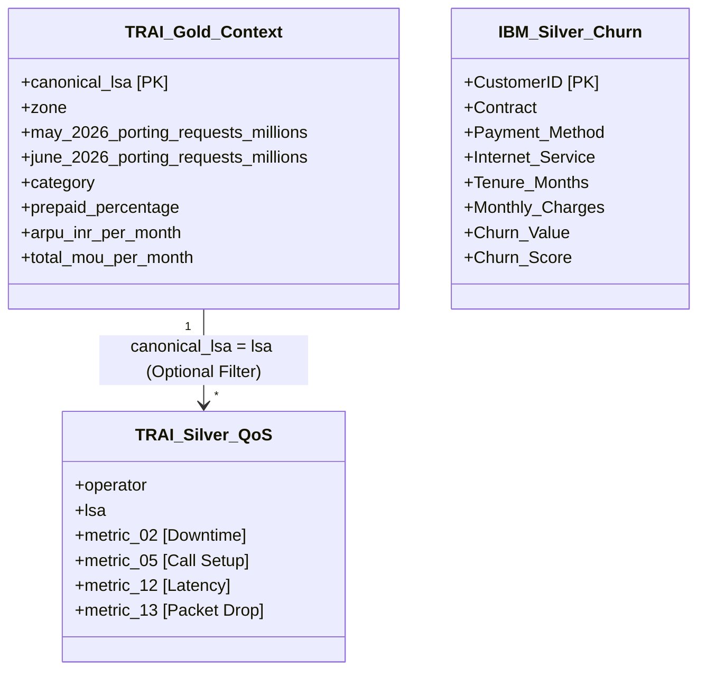

# TelecomNexus — Member 3 Power BI Implementation Guide
### Step-by-Step Power BI Setup, Data Modeling, DAX Measures & Page Specifications

Prepared for: **Member 3 (SQL Analytics, KPIs & Power BI)**  
Project: **TelecomNexus – Network Performance and Customer Churn Analytics**  
Snapshot: **16 November 2026** | Deadline: **20 November 2026**

---

## 1. Responsibilities & Ownership (Member 3)

As defined in the project specification:
- **Core Ownership:**
  1. Confirm Gold table names, schemas, grain, reporting periods, and units with Member 2.
  2. Write and test ANSI SQL queries for agreed KPIs (`sql/` directory).
  3. Document KPI formulas, units, filters, grain, and null handling (`docs/KPI_Dictionary_Member3.md`).
  4. Connect **Power BI Desktop** to Databricks Gold tables (or local CSV export for offline evaluation).
  5. Build the **4-Page Interactive Power BI Report** with slicers and visual cross-filtering.
  6. Reconcile all Power BI headline numbers against independent SQL queries (`sql/04_dashboard_validation.sql`).
- **Core Restrictions:**
  - **Never merge TRAI and IBM records:** They represent completely separate geographies and analytical grains.
  - **Do not invent a QoS `lsa_code` column.**
  - **Do not replace missing QoS values with zero.** Missing means unavailable/unreported.

---

## 2. Step 1: Connecting Power BI to Databricks Gold

### Option A: Connecting to Live Databricks SQL Warehouse
1. Open **Power BI Desktop**.
2. Click **Get Data** → Select **Databricks** (Azure Databricks or Databricks connector).
3. In the connection dialog, enter:
   - **Server Hostname:** `adb-xxxxxxxxxxxxxxxx.xx.azuredatabricks.net` (from Member 2 / `.env`)
   - **HTTP Path:** `/sql/1.0/warehouses/xxxxxxxxxxxxxxxx`
4. Choose **DirectQuery** or **Import**:
   - *DirectQuery:* Queries remain at the source warehouse in real time.
   - *Import (Recommended for college evaluation):* Caches high-performance snapshot of Gold tables in the `.pbix` file.
5. In the Navigator, select the Gold tables:
   - `workspace.gold.trai_lsa_switching_usage_context`
   - `workspace.gold.trai_national_wireless_usage_trends`
   - `workspace.gold.ibm_churn_segment_analysis`
   - `workspace.silver.ibm_telco_customer_churn`
   - `workspace.silver.trai_qos`
   - `workspace.silver.trai_wireless_broadband`
   - `workspace.silver.trai_fixed_wired_broadband`

### Option B: Connecting Offline via Local Gold Datasets (Local Fallback)
If presenting offline without an active cloud compute cluster:
1. Open **Power BI Desktop**.
2. Click **Get Data** → Select **Text/CSV** or **Folder**.
3. Load the cleansed datasets located in `data/bronze/` and `metadata/dim_lsa.csv`.

---

## 3. Step 2: Safe Data Modeling (No Cross-Domain Joins)

> [!CAUTION]
> In Power BI Model View, **do NOT create a relationship between TRAI tables and IBM Telco tables.**  
> They represent independent analytical domains!



---

## 4. Step 3: Standard DAX Measures (Copy & Paste)

Create a dedicated measures table `_Measures` in Power BI and paste the following DAX:

### A. IBM Customer Churn DAX Measures
```dax
// 1. Total Customers
IBM Customers = DISTINCTCOUNT('workspace_silver_ibm_telco_customer_churn'[CustomerID])

// 2. Churned Customers
IBM Churned Customers = 
CALCULATE(
    DISTINCTCOUNT('workspace_silver_ibm_telco_customer_churn'[CustomerID]),
    'workspace_silver_ibm_telco_customer_churn'[Churn_Value] = 1
)

// 3. Retained Customers
IBM Retained Customers = 
CALCULATE(
    DISTINCTCOUNT('workspace_silver_ibm_telco_customer_churn'[CustomerID]),
    'workspace_silver_ibm_telco_customer_churn'[Churn_Value] = 0
)

// 4. Churn Rate (Percentage format)
IBM Churn Rate = DIVIDE([IBM Churned Customers], [IBM Customers], 0)

// 5. Average Monthly Charges (Currency format $)
IBM Avg Monthly Charges = AVERAGE('workspace_silver_ibm_telco_customer_churn'[Monthly_Charges])

// 6. Monthly Recurring Revenue Lost
IBM MRR Lost = 
CALCULATE(
    SUM('workspace_silver_ibm_telco_customer_churn'[Monthly_Charges]),
    'workspace_silver_ibm_telco_customer_churn'[Churn_Value] = 1
)

// 7. Average Tenure (Months)
IBM Avg Tenure = AVERAGE('workspace_silver_ibm_telco_customer_churn'[Tenure_Months])
```

### B. TRAI Industry & QoS DAX Measures
```dax
// 1. May MNP Requests (Millions)
TRAI May Porting M = SUM('workspace_gold_trai_lsa_switching_usage_context'[may_2026_porting_requests_millions])

// 2. June MNP Requests (Millions)
TRAI June Porting M = SUM('workspace_gold_trai_lsa_switching_usage_context'[june_2026_porting_requests_millions])

// 3. Net MoM Porting Change (Millions)
TRAI MoM Porting Change M = [TRAI June Porting M] - [TRAI May Porting M]

// 4. MoM Porting Growth Rate (%)
TRAI MoM Porting Growth % = DIVIDE([TRAI MoM Porting Change M], [TRAI May Porting M], 0)

// 5. Unweighted Average ARPU (INR Currency ₹)
TRAI Unweighted Avg ARPU = AVERAGE('workspace_gold_trai_lsa_switching_usage_context'[arpu_inr_per_month])

// 6. Unweighted Prepaid Share (%)
TRAI Unweighted Prepaid Share % = AVERAGE('workspace_gold_trai_lsa_switching_usage_context'[prepaid_percentage]) / 100

// 7. Average Network Latency (ms)
QoS Avg Latency ms = AVERAGE('workspace_silver_trai_qos'[metric_12])

// 8. Call Setup Success Rate (%)
QoS Call Setup Success % = AVERAGE('workspace_silver_trai_qos'[metric_05]) / 100
```

---

## 5. Step 4: 4-Page Power BI Report Layout & Visual Specifications

### Page 1: TRAI Industry Overview (Indian Porting Dynamics)
- **Top Cards:**
  - Card 1: `[TRAI June Porting M]` (14.79 M)
  - Card 2: `[TRAI May Porting M]` (14.47 M)
  - Card 3: `[TRAI MoM Porting Growth %]` (+2.21%)
  - Card 4: `[TRAI Unweighted Avg ARPU]` (₹ 187.95)
- **Visuals:**
  - **Clustered Bar Chart:** Axis = `canonical_lsa`, Values = `[TRAI May Porting M]`, `[TRAI June Porting M]`.
  - **Donut Chart:** Legend = `zone`, Values = `[TRAI June Porting M]` (Zone I: 53.8%, Zone II: 46.2%).
  - **Table / Matrix:** `canonical_lsa`, `zone`, `category`, `[TRAI May Porting M]`, `[TRAI June Porting M]`, `[TRAI MoM Porting Change M]`.
- **Slicers:**
  - `zone` (Zone I, Zone II)
  - `category` (Metro, Circle A, Circle B, Circle C)

### Page 2: TRAI Usage & Subscribers (Consumption Patterns)
- **Top Cards:**
  - Card 1: `[TRAI Unweighted Prepaid Share %]` (82.8%)
  - Card 2: Average Total MOU (`955.5 mins`)
- **Visuals:**
  - **Stacked Bar Chart:** Axis = `canonical_lsa`, Values = `outgoing_mou_per_month`, `incoming_mou_per_month`.
  - **Bar Chart:** Axis = `category`, Values = `[TRAI Unweighted Avg ARPU]`, Legend = `zone`.
  - **Line Chart (National Trends):** Axis = `reporting_period`, Values = `arpu_inr_per_month`, `revenue_realization_per_gb_inr`.
- **Slicers:** `canonical_lsa`, `zone`.

### Page 3: TRAI Network Quality (QoS Benchmark)
- **Top Cards:**
  - Card 1: `[QoS Call Setup Success %]` (Target ≥ 95%)
  - Card 2: `[QoS Avg Latency ms]` (Target ≤ 30 ms)
- **Visuals:**
  - **Matrix / Heatmap:** Rows = `operator`, Columns = `lsa`, Values = `metric_12` (Latency).
  - **Clustered Column Chart:** Axis = `operator`, Values = `avg_cell_downtime`, `call_setup_success`.
  - **Pie Charts:** Wireless Broadband Market Share (`Reliance Jio: 517M`, `Airtel: 368M`, `Vi: 130M`).
- **Slicers:** `operator` (AIRTEL, BSNL, MTNL, RJIL, VIL), `lsa`.

### Page 4: IBM Customer Churn (Retention Diagnostics)
- **Top Cards:**
  - Card 1: `[IBM Customers]` (7,043)
  - Card 2: `[IBM Churned Customers]` (1,869)
  - Card 3: `[IBM Churn Rate]` (26.54%)
  - Card 4: `[IBM Avg Monthly Charges]` ($64.76)
  - Card 5: `[IBM MRR Lost]` ($139,131 / mo)
- **Visuals:**
  - **Bar Chart 1:** Axis = `Contract`, Values = `[IBM Churn Rate]` (Month-to-month: 42.7%, 1-Yr: 11.3%, 2-Yr: 2.8%).
  - **Bar Chart 2:** Axis = `Payment Method`, Values = `[IBM Churn Rate]` (Electronic check: 45.3%).
  - **Bar Chart 3:** Axis = `Internet Service`, Values = `[IBM Churn Rate]` (Fiber optic: 41.9%).
  - **Bar Chart 4:** Axis = `tenure_band`, Values = `[IBM Churn Rate]` (0-12 Mo: 47.7%).
  - **Scatter Plot:** X = `Tenure_Months`, Y = `CLTV`, Legend = `Churn Label`.
- **Slicers:** `Contract`, `Payment Method`, `Internet Service`, `Gender`, `Senior_Citizen`.

---

## 6. Step 5: Dashboard Validation Against SQL Queries

Before submitting, run `sql/04_dashboard_validation.sql` in Databricks SQL Editor or local SQLite:
1. **Total Customers & Churn Rate:** Must match **7,043** and **26.54%**.
2. **Contract Slicer Verification:** Filtering to `Month-to-month` in Power BI must yield **3,875 customers**, **1,655 churned**, and **42.71% churn rate**.
3. **TRAI National MNP Volume:** Must match **14.47 M (May)** and **14.79 M (June)**.
4. **TRAI Zone I Slicer:** Must match **11 circles**, **7.96 M June porting**, and **₹ 180.27 unweighted ARPU**.
